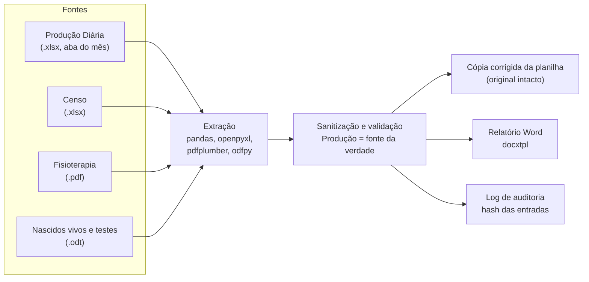

# Automação de indicadores da UTI Pediátrica

[](https://github.com/MatheusCavalcanteF/automacao-indicadores-uti/actions/workflows/ci.yml)

Pipeline em Python que gera o relatório mensal de avaliação dos indicadores de uma UTI Pediátrica a partir das planilhas, do PDF e do ODT que a equipe já produz, e entrega o documento Word pronto para revisão.

## O problema

Todo mês, os indicadores (taxa de ocupação, média de permanência, mortalidade, uso de ventilação mecânica, cateteres, flebite, quedas, testes de triagem neonatal etc.) eram consolidados à mão:

1. os dados diários eram lançados numa planilha de Produção Diária, com uma aba por mês;
2. os totais eram copiados para outra planilha, só para calcular as taxas;
3. os resultados, junto com o Censo hospitalar, o relatório da Fisioterapia (PDF) e a planilha de nascidos vivos e testes (ODT), eram redigitados num relatório Word de dezenas de páginas.

Cada cópia era uma chance de erro, e fórmulas quebradas na planilha (TOTAL que esquece um dia, taxa digitada em % em vez de fração) passavam direto para o relatório.

## Como funciona



| Etapa | Módulo | O que faz |
|---|---|---|
| Localização | `scripts/localizar_arquivos.py` | Escolhe o arquivo de cada fonte pelo mês e ano no nome. Data de modificação só como último recurso, com aviso. |
| Extração | `scripts/extracao_*.py` | Lê a aba do mês achando a linha `DATAS` (sem `skiprows` fixo), o resumo do Censo com cabeçalho mesclado, as seções de ventilação mecânica do PDF e a tabela de testes do ODT. |
| Sanitização | `scripts/sanitizacao.py` | Concilia Censo x Produção e recalcula taxas e totais quebrados a partir do próprio bloco. Cada mudança vira uma linha `[INFO]` ou `[CORREÇÃO]`. |
| Write-back | `scripts/corrigir_planilha.py` | Grava as fórmulas corrigidas numa cópia da planilha com um patch no XML da célula, preservando gráficos e desenhos. |
| Validação | `scripts/validacao.py` | Confere se a aba é do mês certo, se as proporções estão entre 0 e 1, se TOTAL bate com a soma dos dias e se as fontes concordam entre si. |
| Relatório | `scripts/gerador_relatorio.py` | Preenche o modelo Word com filtros Jinja (`pct`, `dec`, `num`, `dia`). |
| Modelo | `scripts/montar_template.py` | Converte o relatório de um mês anterior no modelo docxtpl: números viram variáveis e análises e listas nominais viram `[PREENCHER]`. |

## Decisões de engenharia

- **A Produção Diária é a fonte da verdade.** Quando o Censo diverge, vale o número da Produção, e a divergência fica registrada como `[INFO]`. Fórmula quebrada é recalculada a partir dos componentes do próprio bloco, nunca estimada.
- **O original nunca é alterado.** As correções vão para `<nome>_Corrigida_<MÊS>.xlsx`, com o mês no nome para que rodar outro mês não apague a cópia de auditoria anterior. A cópia corrigida nunca é lida como fonte.
- **Escrita atômica.** A cópia é gravada num `.tmp` e só então renomeada, para que uma falha no meio não deixe uma planilha corrompida.
- **`[Sem Dados]` em vez de falhar.** Só a Produção é obrigatória. Fonte ausente, ou existente só de outro mês, não interrompe nada: as variáveis dela saem como `[Sem Dados]` e o Word abre com uma página "AVISOS CRÍTICOS E PENDÊNCIAS". Valor inválido que não dá para recalcular vira `[Valor Inválido na Planilha]`, nunca um chute.
- **`--estrito` para quando o relatório vai direto para frente.** Com ele, erro crítico ou fonte ausente impede a geração do Word.
- **Códigos de saída** para uso em script ou agendador:

  | Código | Significado |
  |---|---|
  | 0 | relatório gerado |
  | 1 | falha (ex.: sem planilha de Produção) |
  | 2 | argumentos inválidos |
  | 3 | bloqueado pelo modo estrito |

- **Log de auditoria por execução.** O arquivo `execucao_<MÊS>_<ANO>_<AAAAMMDD_HHMMSS>.log` tem tudo o que saiu no terminal e mais o SHA-256 e a data de modificação de cada arquivo de entrada, o comando e o código de saída. Assim dá para provar qual versão de cada arquivo gerou cada relatório.

## Rodando com dados fictícios

Requer Python 3.12 ou superior.

```bash
python -m venv .venv
source .venv/bin/activate          # Windows: .venv\Scripts\activate
pip install -r requirements.txt

python scripts/gerar_dados_exemplo.py
python main.py setembro 2026 --pasta-entrada exemplo/dados_entrada --pasta-saida exemplo/relatorios_gerados
```

O gerador cria uma planilha de Produção Diária e um Censo fictícios (seed fixa, "Hospital Exemplo") com três inconsistências de propósito:

- uma taxa de mortalidade digitada em %;
- um TOTAL que esquece o último dia, com a taxa de CVC calculada a partir dele;
- um paciente-dia do Censo diferente do da Produção.

PDF e ODT ficam de fora de propósito. A execução mostra a sanitização em ação:

```text
[INFO] Censo x Produção divergem em censo_paciente_dia (censo=268, produção=265); adotado o valor da Produção.
[CORREÇÃO] taxa_de_mortalidade_em_uti: planilha trouxe 3.03; recalculado n_de_obitos / n_total_de_saidas = 0.0303.
[EXCEL] UTI PEDIATRICA SETEMBRO!AF43: 258 -> =SUM(B43:AE43) (= 265)
```

Saídas em `exemplo/`:

- relatório Word (abre com a página de avisos, porque faltam PDF e ODT);
- cópia corrigida da planilha;
- log de auditoria;
- `mapa_variaveis.txt` com cada valor que foi para o Word.

Sem `templates/modelo_relatorio.docx`, o pipeline cria um modelo mínimo com todas as variáveis.

Com `--estrito`, a mesma execução termina com código 3 e não gera o Word.

Opções: `python main.py --help`. O mês aceita `setembro`, `set`, `9`, `set/2026` ou `09-2026`.

## Testes

```bash
pip install -r requirements-dev.txt
python -m pytest
pip-audit -r requirements.txt
```

Os testes usam só dados sintéticos criados em pasta temporária:

- sanitização, write-back e escrita atômica;
- página de avisos e dias 29 a 31 nas tabelas diárias;
- interpretação de mês e ano;
- log de auditoria;
- execução ponta a ponta com os dados fictícios, incluindo `--estrito` e falta da planilha de Produção.

O CI roda tudo isso em Python 3.12 e 3.14 a cada push e PR, e o Dependabot propõe atualizações semanais.

## Estrutura

```text
main.py                     orquestra o pipeline (CLI)
scripts/                    extração, sanitização, validação, write-back, relatório, modelo, gerador do exemplo
tests/                      testes com dados sintéticos
dados_entrada/              fontes reais do mês        (ignorada pelo git)
relatorios_gerados/         relatórios e logs          (ignorada pelo git)
templates/                  modelo Word                (ignorada pelo git)
exemplo/                    dados fictícios e saídas   (gerada, ignorada pelo git)
```

## Dados e LGPD

Este repositório não contém nenhum dado real: nem de pacientes, nem de profissionais, nem do hospital.

- As pastas de entradas reais, relatórios gerados, modelos Word e o `mapa_variaveis.txt` estão no `.gitignore`. Os relatórios e o documento-base do modelo podem conter dados pessoais de saúde (o modelo remove a lista nominal de pacientes, mas o documento de origem tem).
- Os dados de `exemplo/` são gerados na hora por `scripts/gerar_dados_exemplo.py`. São aleatórios, sem nomes de pessoas, e o gerador se recusa a gravar na pasta de dados reais.
- O log de auditoria grava o usuário e o nome da máquina que rodou o pipeline. Ele fica só na pasta de saída local, que também é ignorada.

Detalhes e como reportar um problema de segurança: [docs/SECURITY.md](docs/SECURITY.md).
